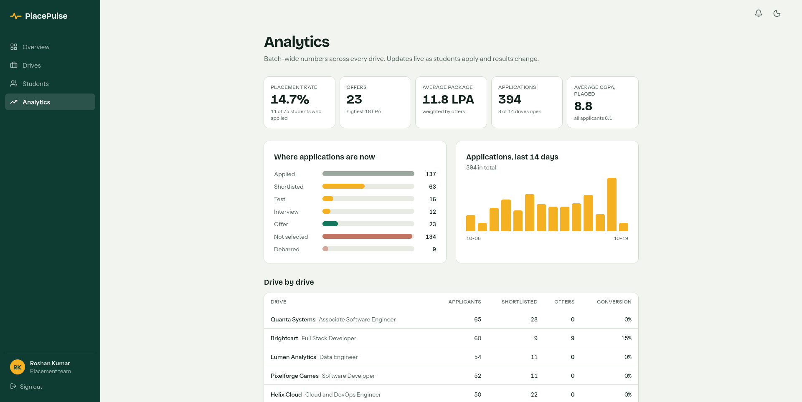
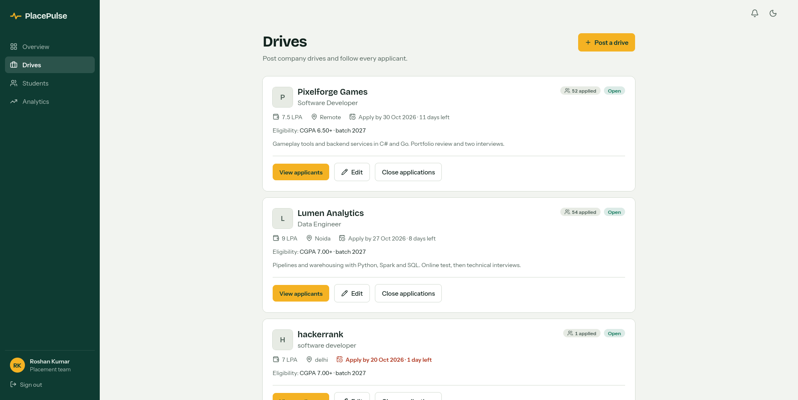
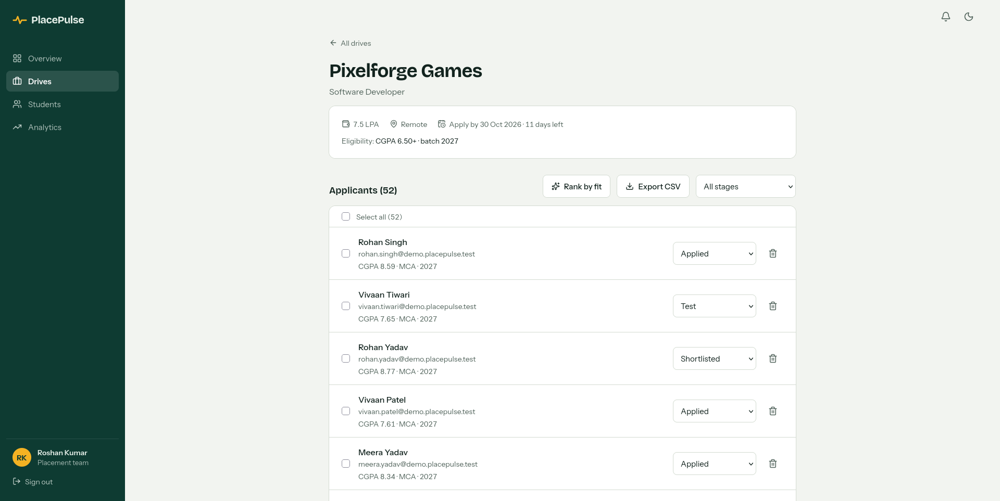
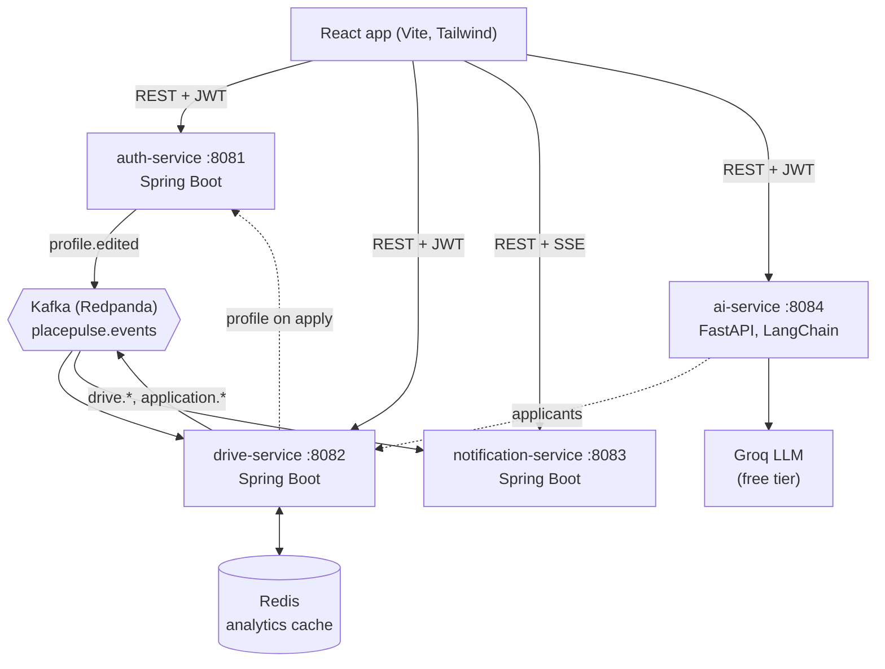

# PlacePulse

**A campus placement platform for a training and placement cell.** Placement reps post drives, students apply, everyone sees changes live, and an AI resume matcher scores each applicant against the job description. Built as four small services that talk over REST and Kafka.

[](https://github.com/Roshu09/PlacePulse/actions/workflows/ci.yml)

I built it because I am the placement representative (TPR) for a 75-student MCA batch, and spreadsheets and WhatsApp groups kept losing track of who applied where.

<!-- Add real screenshots to docs/screenshots/ (see docs/screenshots/README.md), then keep these lines. -->


<p>
  
  
</p>

## What it does

**For students**
- A Superset-style profile with required and optional sections and a completeness bar.
- Registering for placements locks the profile. Editing it afterwards needs an explicit confirmation, because it **debars** the student from drives they are still in. A TPR can reinstate them.
- Eligibility is checked on the server (CGPA, pass-out year, registration), and each drive shows how many days are left.
- Upload a resume PDF and see how well it matches a drive: a score, matched skills, missing skills and suggestions.

**For placement reps**
- Post and edit drives with multiple eligible batches and a company logo.
- See applicants per drive, rank them by resume fit, move many through stages at once, remove an application so a student can reapply, and export a CSV.
- An analytics page: placement rate, offers, average and highest package, the stage funnel, per-drive conversion and a 14-day application curve.

**For everyone**
- Notifications and dashboards update live, with no refresh (Server-Sent Events).

## Architecture



One Postgres instance runs four databases (`auth_db`, `drive_db`, `notification_db`, `ai_db`), and each service only touches its own. Every service verifies the same JWT, so there is no shared session.

| Service | Stack | Owns |
|---|---|---|
| auth-service | Spring Boot, Spring Security, JWT | accounts, roles, student profiles, placement registration |
| drive-service | Spring Boot, JPA, Kafka, Redis | drives, eligibility rules, applications and stages, analytics |
| notification-service | Spring Boot, Kafka, SSE | per-user notifications and the live stream |
| ai-service | Python, FastAPI, LangChain, fastembed, Groq | resume parsing, embeddings, JD matching |

## Design decisions worth asking about

- **Kafka for side effects.** Applying to a drive publishes an event and returns. Notifications and profile-lock handling react on their own, so a slow or failed consumer never slows the student down.
- **Publish after commit, fail open.** Events go out only after the database transaction commits, and a broker outage is logged, never shown to the user. Applying works with Kafka down.
- **At-least-once, made safe.** The consumer is idempotent (a notification is unique per event and recipient), retries a failing message three times, then parks it on a dead-letter topic.
- **Live updates over SSE.** The browser reads the stream with `fetch` so the JWT stays in a header, reconnects with backoff, re-syncs after a reconnect and falls back to polling.
- **Cache that fails safe.** Analytics are aggregated in the database and cached in Redis. Every write clears the key, a 60 s TTL is the backstop, and a Redis outage only makes the page slower.
- **Free AI stack.** Embeddings run locally (fastembed, `BAAI/bge-small-en-v1.5`), the six most relevant resume sections are retrieved, and only those go to a Groq model, which must return JSON that passes strict validation. Results are cached per student and drive, and the matcher falls back to a similarity score if the LLM is unavailable. Resume text is treated as untrusted input.

## Measured results

Measured on one development laptop with synthetic data, using `scripts/bench-analytics.sh`. 88,297 applications across 206 drives, 200 requests per case.

| `GET /api/analytics` | No cache | Redis | Speedup |
|---|---|---|---|
| Sequential, average | 108.1 ms | 2.2 ms | about 49x |
| Sequential, p95 | 115.8 ms | 3.1 ms | about 37x |
| 20 parallel clients, average | 339.8 ms | 5.3 ms | about 64x |
| 20 parallel clients, p95 | 433.0 ms | 9.7 ms | about 45x |

With Redis stopped, the dashboard kept working from the database, and it went back to cache hits about 2 seconds after Redis returned, with no restart.

Reproduce it:

```bash
./scripts/seed-analytics.sh 100000
TPR_EMAIL=you@example.com TPR_PASSWORD=... ./scripts/bench-analytics.sh 200
./scripts/seed-analytics.sh --clean
```

`./scripts/seed-demo.sh` loads a small realistic season (8 fictional companies, 75 students) for screenshots.

## Run it locally

Needs Docker, Java 21 (not 25), Node 22 and Python 3.12.

```bash
cp .env.example .env                 # then set real passwords and a JWT secret
./scripts/set-groq-key.sh            # optional: free key from console.groq.com
./start-backend.sh                   # Postgres, Redis, Redpanda and all four services

cd frontend && npm install && npm run dev      # http://localhost:5173
```

Register as a student, or as a TPR by entering `TPR_INVITE_CODE` from your `.env`. The Kafka console is at http://localhost:8089.

Tests: `mvn test` inside each Spring service (in-memory H2, no Docker needed), `pytest` in `services/ai-service`, and `npm run build` in `frontend`. GitHub Actions runs all of them and builds the Docker images on every push.

## Limitations (on purpose, for now)

- Services are called directly by the browser (CORS is limited to `localhost:5173`). There is no API gateway yet.
- Not deployed. It runs locally with Docker Compose.
- The benchmark is local and synthetic, so the absolute numbers will differ elsewhere. The before and after comparison on the same machine is the point.
- The resume matcher needs text PDFs, since scanned images are rejected.

## More

- [API reference](docs/API.md): every endpoint, the event types and the reliability rules.
- Roadmap: auth, drives, live updates, profile lock, AI matcher, analytics and CI are done. Still to do: load test, deployment and a demo video.
